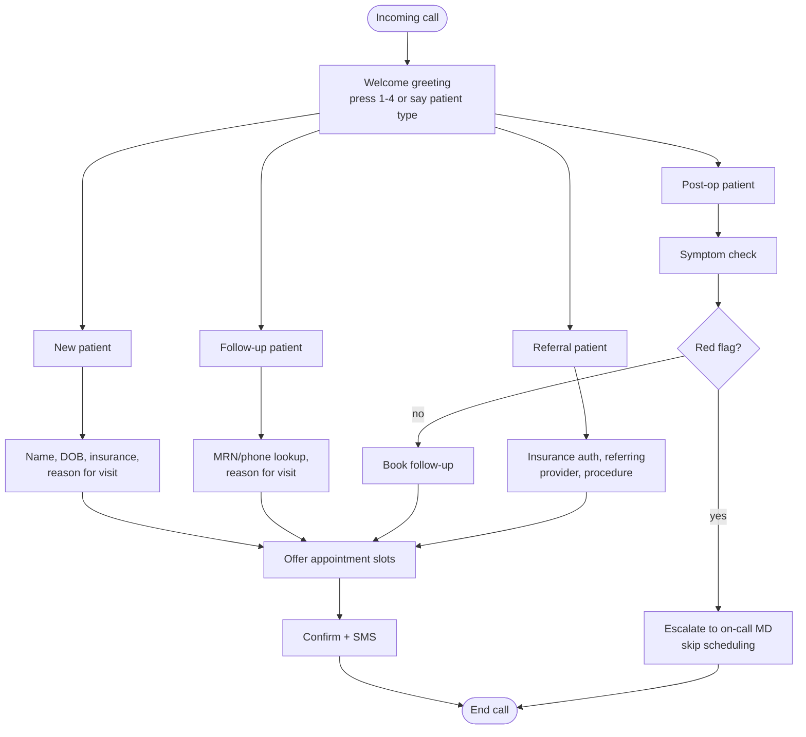

# CLAUDE.md

## Project

A phone-based virtual receptionist for a small general surgery clinic. The system is an **IVR-first, AI-for-extraction** design: pre-recorded/TTS-cached menu prompts drive the call structure, and the AI stack is invoked narrowly — to pull structured data (names, dates, symptoms, insurance info) out of the caller's spoken answers — rather than to carry open-ended conversation. This is a deliberate latency and reliability choice, not a limitation we're working around.

**The receptionist must operate fully in Spanish.** Every piece of caller-facing output — greetings, menu prompts, re-prompts, confirmations, error/fallback messages, the SMS confirmation text, the escalation message — is in Spanish, with no English fallback at any point in the call. This is not a locale toggle to leave for later; it's a hard requirement of the prototype from day one. See the dedicated **Language requirement** section below before touching any prompt copy, TTS config, or STT setup.

This is a **prototype**. The goal right now is a working end-to-end call: greeting → patient-type routing → guided data collection → slot confirmation → SMS confirmation. EHR writes and staff-review queues are explicitly out of scope until the core flow is solid (see Non-goals).

## Non-negotiable architecture constraint

Everything that understands or generates call content runs **on-prem**, on the local machine with the RTX 4070 Ti (12GB VRAM). Twilio is a PSTN bridge only — it carries raw audio over Media Streams and never sees a transcript, an extracted field, or any patient data.

- STT, LLM inference, and TTS all run locally. Do not introduce a cloud STT/LLM/TTS dependency (Deepgram, OpenAI, ElevenLabs, etc.) without an explicit, recorded exception the way `LOCAL_CALENDAR` was handled in the prior project.
- The pipeline service binds to `127.0.0.1` only. Never make it internet-reachable.
- If a task seems to require sending transcript or PHI content to a third-party API, stop and flag it instead of implementing it.

## Language requirement

The clinic's caller base is Spanish-speaking. Spanish is not a configuration option among several — it is the only supported language for this prototype. This affects every layer:

- **STT**: `WHISPER_LANGUAGE=es` is hardcoded for this deployment, not left as a configurable default. Do not add auto-language-detection or an English fallback path — if `faster-whisper` mis-transcribes, that's a STT-quality problem to fix (better prompting, a larger model tier if latency allows), not a reason to switch languages.
- **TTS**: whichever engine is active (Piper or MeloTTS, via `TTS_ENGINE`) must be configured with a Spanish voice/model. Confirm the specific voice/locale (e.g. `es-MX`, `es-ES`, or a Latin-American neutral variant, matching the clinic's patient population) before caching any prompts — re-caching after the fact means re-recording every prompt.
- **Cached prompts**: every string in `tts/cache.js` — greeting, per-patient-type menu options, all re-prompts, escalation message, closing message — is written and recorded in Spanish. Don't stub these in English "to get the flow working" and translate later; wrong-language audio caught late means re-testing the whole call flow.
- **Extraction prompts**: the *instructions* sent to the LLM in `extract.js` (the JSON schema, the "respond with JSON only" framing) can stay in English — that's an internal, non-caller-facing implementation detail and doesn't affect what the caller hears. But the transcript text being extracted from is Spanish, and any extracted *values* that get read back to the caller (a confirmed date, a confirmed name) must be formatted and spoken in Spanish (day/month names, date order, etc.).
- **Red-flag keywords** (`redFlags.js`): the keyword list must be written in Spanish to match what `faster-whisper` actually transcribes (e.g. fiebre, sangrado, dolor de pecho, no puedo respirar, inconsciente) — an English keyword list run against Spanish transcripts will silently fail to catch anything.
- **SMS confirmation text**: written and sent in Spanish.

If any task touches a caller-facing string, prompt, or voice config, treat "is this in Spanish" as a blocking check before considering the task done.

## Why IVR-first instead of full conversational AI

Full LLM-in-the-loop conversation (STT → 14B-model inference → TTS per turn) costs 2–8s per turn on this hardware, and TTS synthesis is the single biggest cost. Pre-recorded/cached prompts plus extraction-only LLM calls cut that to roughly 800ms–1.5s per turn:

- Menu prompts and known phrasing are pre-recorded or TTS-cached at startup, not synthesized per call.
- The LLM is only asked to extract structured fields from a narrow, known-shape answer ("what day did you say?" → `{"day": "Tuesday"}"`), never to carry the conversation. Small extraction prompts (~50 tokens in, ~10 tokens out) run far faster than open-ended generation.
- Red-flag keyword gating happens **before** any LLM call, in plain code, so a model hiccup can never suppress an escalation.

## Repo layout

```
src/
  server/
    audioCodec.js            # existing — reuse as-is
    speechOnsetDetector.js   # existing — reuse as-is
    turnDetector.js          # existing — reuse as-is
    ivr/
      menu.js                # top-level greeting + patient-type routing (DTMF + speech)
      flows/
        newPatient.js
        followUp.js
        postOp.js
        referral.js
      scheduling.js          # shared slot-offer / slot-confirm step
    extraction/
      extract.js             # thin wrapper around Ollama calls, JSON-only prompts
      schemas.js              # per-field JSON schemas (name, dob, insurance, symptoms, etc.)
      redFlags.js             # plain-code keyword gate, runs before any LLM call
    db/
      schema.sql               # SQLite prototype schema
      patients.js
      appointments.js
    tts/
      cache.js                 # pre-synthesizes and caches fixed prompts at startup
    index.js                   # Express + Twilio Media Streams entrypoint
```

`audioCodec.js`, `speechOnsetDetector.js`, and `turnDetector.js` carry over unchanged from the previous project — they're audio-layer concerns (encoding, VAD, turn-taking) that don't care whether the thing downstream is a full conversational agent or an extraction pipeline. Don't modify their public interfaces without checking both call sites.

## Call flow

Four patient types, selected at the top of the call (DTMF digit or spoken keyword), each collecting a different data set, all converging on a shared scheduling step:



### New patient
Fields: full name, DOB, phone, insurance provider + policy/group number, allergies, chief complaint. Heaviest data-collection path — expect 4–5 extraction turns.

### Follow-up patient
Fields: MRN or phone (DB lookup, not a fresh record), reason for visit (routine vs. concerning). Lightest path — 2 extraction turns.

### Post-op patient
Fields: date of surgery (to look up the procedure), symptom check (fever, bleeding, drain output, pain level). The symptom check runs through `redFlags.js` **before** anything touches the LLM — if a red-flag phrase matches, skip straight to escalation and do not attempt scheduling.

### Referral patient
Fields: insurance authorization status/code, referring provider name + fax, procedure/consultation type. Also do a quick check for an existing MRN before treating them as brand-new.

All four paths converge on the shared `scheduling.js` flow: offer slots → confirm selection → SMS confirmation.

### Getting out: the 0 key

The caller base is mostly elderly. Two keys work from **any** point in the call, checked in `session.onDtmf` before any state-specific routing:

- **0** — leave the automated flow and transfer to `SCHEDULING_NUMBER` (escalation reason `caller_request`; it must never page the on-call surgeon). Nothing collected so far is written. Announced in the greeting and repeated in every re-prompt.
- **\*** — start over at the main menu, discarding everything collected.

Treat 0 the way the red-flag gate is treated: the way out must not depend on the call being in a state that understands it. Don't move that check inside a state branch, and don't make it conditional on the flow.

## Extraction pipeline design

Each data-collection step follows the same pattern:

1. Play/stream the prompt (cached TTS, not synthesized live).
2. Capture the caller's speech via `speechOnsetDetector.js` / `turnDetector.js` as before.
3. Run STT (`faster-whisper`, `small`, int8, CPU) with `WHISPER_LANGUAGE=es` — see Language requirement above, this is fixed for this deployment, not a per-clinic option.
4. Send the transcribed text through `extract.js` with a small, JSON-only prompt against the field's schema in `schemas.js`.
5. Check the model's self-reported confidence:
   - `>= 0.7`: accept and move to the read-back step below.
   - `< 0.7`: re-prompt once, asking the caller to repeat or rephrase.
   - Fails 3 times total: bail out of AI extraction for that field and route the call to a human ("I'm having trouble understanding — let me connect you to our scheduling team.").
6. **Read the accepted value back to the caller in Spanish and wait for a sí/no** ("Entendí que nació el 12 de marzo de 1938. ¿Es correcto?"). Nothing reaches `this.data` — or the DB — until they agree. A confident extraction is not a correct one: STT on an elderly caller over a phone line mishears digits and surnames, and a wrong DOB or phone number is otherwise invisible until the day of the visit. Rejecting a read-back re-asks that same question and counts as an attempt, so it still ends at a human after 3.

The read-back sentence is the only per-field live TTS in the call (~230–390ms on this hardware); the "¿Es correcto?" question after it is cached like every other fixed prompt. Read-back copy per field lives in `fieldReadbackText()` in `prompts.js`, and numbers are spelled out digit by digit ("7 8 7, 4 9 0, 2 0 8 1") because espeak-ng otherwise reads a phone number as one enormous Spanish numeral.

Example extraction prompt shape (keep these short — this is the whole latency win):

```
Extract the appointment day from the caller's answer. Respond with JSON only, no prose.
Schema: {"day": string, "confidence": number}
Caller said: "{transcript}"
```

Do not let extraction prompts grow into multi-turn conversation. If a field needs conversational back-and-forth to resolve, that's a signal that field belongs in the human-escalation path, not a bigger prompt.

## Red flag / triage gate

`redFlags.js` is plain string/keyword matching, not a model call. It runs on the raw Spanish transcript before extraction and before any tool-calling logic. Known trigger phrases — fiebre, sangrado abundante, dolor de pecho, no puedo respirar, inconsciente, and their common variants/conjugations — immediately short-circuit to escalation. This mirrors the lesson from the prior project: a conversational model reliably mishandled emergency phrases (calling scheduling tools on a chest-pain mention), so the gate must live outside the model, not be an instruction the model is trusted to follow. Keep the keyword list in Spanish only; don't add English equivalents "just in case" since they'll never match a Spanish transcript and just add noise to maintain.

## Data model (prototype scope)

SQLite only for now — no Google Calendar API, no EHR write path. Keep it simple:

```sql
-- schema.sql
CREATE TABLE patients (
  mrn TEXT PRIMARY KEY,
  first_name TEXT,
  last_name TEXT,
  dob TEXT,
  phone TEXT,
  insurance_provider TEXT,
  policy_number TEXT,
  group_number TEXT,
  allergies TEXT,
  created_at TEXT DEFAULT (datetime('now'))
);

CREATE TABLE referrals (
  id INTEGER PRIMARY KEY AUTOINCREMENT,
  mrn TEXT REFERENCES patients(mrn),
  referring_provider TEXT,
  referring_fax TEXT,
  authorization_code TEXT,
  procedure_type TEXT,
  received_at TEXT DEFAULT (datetime('now'))
);

CREATE TABLE appointments (
  id INTEGER PRIMARY KEY AUTOINCREMENT,
  mrn TEXT REFERENCES patients(mrn),
  patient_type TEXT CHECK(patient_type IN ('new','follow_up','post_op','referral')),
  scheduled_date TEXT,
  scheduled_time TEXT,
  reason TEXT,
  extraction_confidence REAL,
  created_at TEXT DEFAULT (datetime('now'))
);
```

No `needs_review` or staff-queue columns yet — add them when that phase actually starts. Don't build ahead of the current priority.

## Explicit non-goals for this phase

Do not implement these yet, even if they seem like natural next steps:

- **EHR integration** (writing to an external EHR system). SQLite is the only persistence layer right now.
- **Staff review queue** for flagging low-confidence extractions for human double-check. Log confidence scores to the DB (the column above is fine) but don't build a review UI or workflow around it.
- **Google Calendar API** or any other cloud scheduling backend — SQLite only, matching the `LOCAL_CALENDAR=true` default from the prior project.

If a task description implies one of these, flag it back rather than quietly building it — the priority right now is getting the core call flow working end-to-end.

## Environment / dependencies

- Node.js / Express for call orchestration and the Twilio Media Streams WebSocket handling.
- `faster-whisper` (small, int8, CPU) for STT, forced to `WHISPER_LANGUAGE=es` — no auto-detect, no English fallback.
- Ollama serving `qwen2.5:14b` (Q4_K_M) for extraction — same model as the prior project; don't swap models without testing against the red-flag and multi-field extraction cases first (see the `llama3.1:8b` rejection history — that model looped and mis-fired tool calls under load). Verify a candidate model's Spanish extraction accuracy specifically — good English extraction performance doesn't guarantee good Spanish performance.
- TTS via Piper or MeloTTS (`TTS_ENGINE` switchable), configured with a Spanish voice. Pre-synthesize and cache all IVR menu prompts at startup via `tts/cache.js`, in Spanish, rather than generating them live per call. Speaking pace is deliberately slower than the voice's native rate for this caller base (`TTS_LENGTH_SCALE`, default 1.25 — higher is slower); changing it invalidates the cached prompts, so restart the Node server and re-audition with `scripts/make-voice-samples.py`.
- SQLite (`better-sqlite3` or similar) for the prototype DB.

## Testing priorities for this phase

1. A full call through each of the four patient-type paths, with a human on the other end, confirming data lands correctly in SQLite.
2. Red-flag phrases in the post-op symptom check reliably escalate without reaching the LLM extraction step (unit-test `redFlags.js` directly — don't rely on the model to "not call scheduling" on an emergency phrase).
3. Low-confidence extraction triggers a single re-prompt, then falls back to human escalation after repeated failure — verify the 3-strike bailout actually fires.
4. Rough per-turn latency measurement (STT + extraction) to confirm we're in the ~800ms–1.5s range, not silently falling back to full conversational generation somewhere.
5. Every caller-facing prompt, confirmation, and the SMS text played/sent in a full test call is in Spanish — spot-check the cached TTS audio and the SMS template directly, don't just trust that the source strings were written in Spanish.
6. Pressing 0 at each stage of a call (menu, mid-collection, at a read-back, in scheduling) reaches the scheduling team and books nothing.
7. Read-backs are intelligible at the configured pace over a real phone line — especially phone numbers and dates, which is what the caller has to catch on one hearing — and rejecting one ("no") re-asks that field instead of moving on.