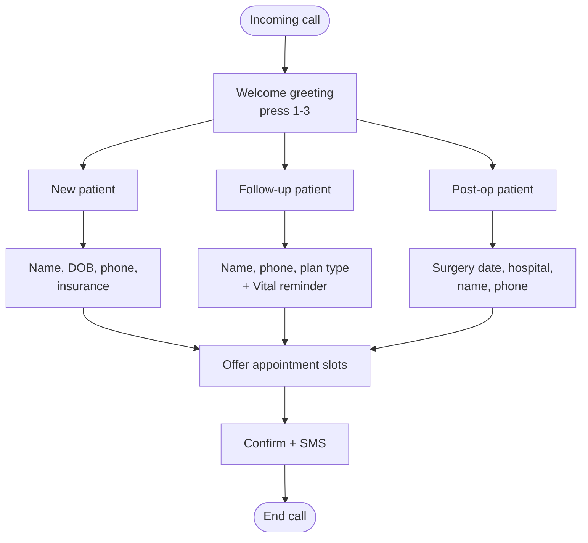

# CLAUDE.md

## Project

A phone-based virtual receptionist for a small general surgery clinic. The system is an **IVR-first, AI-for-extraction** design: pre-recorded/TTS-cached menu prompts drive the call structure, and the AI stack is invoked narrowly — to pull structured data (names, dates, hospitals, insurance info) out of the caller's spoken answers — rather than to carry open-ended conversation. This is a deliberate latency and reliability choice, not a limitation we're working around.

**The main target population is senior patients.** The clinic's callers are mostly elderly, Spanish-speaking Puerto Rico residents, and that drives design decisions throughout — the slowed-down TTS pace (`TTS_LENGTH_SCALE`), the 1.8s mid-answer pause tolerance in the turn detector (elderly callers pause while recalling dates and digits), digit-by-digit phone-number read-backs, the per-field read-back confirmation before anything is stored, and the always-available 0 key to reach a person. When weighing a UX trade-off, optimize for a caller who is elderly, catches things on one hearing at best, and may struggle with an automated system — not for call brevity.

**The receptionist must operate fully in Spanish.** Every piece of caller-facing output — greetings, menu prompts, re-prompts, confirmations, error/fallback messages, the SMS confirmation text, the handoff messages — is in Spanish, with no English fallback at any point in the call. This is not a locale toggle to leave for later; it's a hard requirement of the prototype from day one. See the dedicated **Language requirement** section below before touching any prompt copy, TTS config, or STT setup.

This is a **prototype**. The goal right now is a working end-to-end call: greeting → patient-type routing → guided data collection → slot confirmation → SMS confirmation. EHR writes and staff-review queues are explicitly out of scope until the core flow is solid (see Non-goals).

## Non-negotiable architecture constraint

Everything that understands or generates call content runs **on-prem**, on the local machine with the RTX 4070 Ti (12GB VRAM). Twilio is a PSTN bridge only — it carries raw audio over Media Streams and never sees a transcript, an extracted field, or any patient data.

- STT, LLM inference, and TTS all run locally. Do not introduce a cloud STT/LLM/TTS dependency (Deepgram, OpenAI, ElevenLabs, etc.) without an explicit, recorded exception the way `LOCAL_CALENDAR` was handled in the prior project.
- The pipeline service binds to `127.0.0.1` only. Never make it internet-reachable.
- If a task seems to require sending transcript or PHI content to a third-party API, stop and flag it instead of implementing it.
- **Recorded exception (2026-07): Google Calendar mirror.** Outbound HTTPS to the Google Calendar API is allowed for the one-way, push-only appointment mirror (see Data model). The only data that may appear in a calendar event is the patient's name and patient type — never a phone number, DOB, MRN, reason for visit, or any transcript text. `src/server/calendar/sync.js` (`buildEvent`) is the single place event payloads are built; keep it that way so the boundary stays auditable. This exception does not loosen anything else: inbound traffic still binds `127.0.0.1`, and STT/LLM/TTS stay local.

## Language requirement

The clinic's caller base is Spanish-speaking. Spanish is not a configuration option among several — it is the only supported language for this prototype. This affects every layer:

- **STT**: `WHISPER_LANGUAGE=es` is hardcoded for this deployment, not left as a configurable default. Do not add auto-language-detection or an English fallback path — if `faster-whisper` mis-transcribes, that's a STT-quality problem to fix (better prompting, a larger model tier if latency allows), not a reason to switch languages.
- **TTS**: the voice is settled — Piper with `PIPER_VOICE=es_AR-daniela-high` (Latin-American Spanish, auditioned via `scripts/make-voice-samples.py`). Don't switch voices casually: cached prompts are re-synthesized from it at startup, and a voice change means re-auditioning and re-testing the whole call flow.
- **Cached prompts**: every string in `PROMPTS` in `prompts.js` — greeting, per-patient-type menu options, all re-prompts, handoff messages, closing message — is written in Spanish and pre-synthesized at startup by `tts/cache.js`. Don't stub these in English "to get the flow working" and translate later; wrong-language audio caught late means re-testing the whole call flow.
- **Extraction prompts**: the *instructions* sent to the LLM in `extract.js` (the JSON schema, the "respond with JSON only" framing) can stay in English — that's an internal, non-caller-facing implementation detail and doesn't affect what the caller hears. But the transcript text being extracted from is Spanish, and any extracted *values* that get read back to the caller (a confirmed date, a confirmed name) must be formatted and spoken in Spanish (day/month names, date order, etc.).
- **SMS confirmation text**: written and sent in Spanish.

If any task touches a caller-facing string, prompt, or voice config, treat "is this in Spanish" as a blocking check before considering the task done.

## Why IVR-first instead of full conversational AI

Full LLM-in-the-loop conversation (STT → 14B-model inference → TTS per turn) costs 2–8s per turn on this hardware, and TTS synthesis is the single biggest cost. Pre-recorded/cached prompts plus extraction-only LLM calls cut that to roughly 800ms–1.5s per turn:

- Menu prompts and known phrasing are pre-recorded or TTS-cached at startup, not synthesized per call.
- The LLM is only asked to extract structured fields from a narrow, known-shape answer ("what day did you say?" → `{"day": "Tuesday"}"`), never to carry the conversation. Small extraction prompts (~50 tokens in, ~10 tokens out) run far faster than open-ended generation.

## Repo layout

```
src/
  server/
    audioCodec.js            # existing — reuse as-is
    turnDetector.js          # existing — reuse as-is
    prompts.js               # ALL caller-facing Spanish copy: PROMPTS + dynamic sentence builders
    ivr/
      menu.js                # patient-type routing tables (DTMF 1-3 -> flow)
      session.js             # per-call state machine: DTMF/transcript in, action list out
      flows/
        newPatient.js
        followUp.js
        postOp.js
        phoneSteps.js        # shared phone question (keypad caller-ID offer + dictated variant)
        insuranceTypeStep.js # shared comercial-vs-Vital accept() (new patient + follow-up)
      scheduling.js          # shared window -> slot-offer -> confirm -> book step
    extraction/
      extract.js             # thin wrapper around Ollama calls, JSON-only prompts
      schemas.js             # per-field extraction specs (name, dob, insurance, hospital, etc.)
    db/
      index.js               # opens SQLite, applies schema + column migrations
      schema.sql             # SQLite prototype schema
      patients.js
      appointments.js        # slot search + booking
    calendar/
      googleClient.js        # OAuth token handling for the Calendar mirror
      sync.js                # one-way push-only mirror; buildEvent is the PHI boundary
    tts/
      cache.js               # pre-synthesizes and caches fixed prompts at startup
    index.js                 # Express + Twilio Media Streams entrypoint (binds 127.0.0.1)
speech/                      # Python FastAPI sidecar (127.0.0.1:8081): /stt (faster-whisper) + /tts (Piper)
scripts/
  dev.sh                     # starts sidecar + server together
  simulate-call.js           # end-to-end simulated call (everything real except Twilio)
  extract-harness.js         # canned Spanish transcripts vs. the live extraction layer
  make-voice-samples.py      # audition TTS voices before caching prompts
  stt-benchmark.py           # STT model/device latency comparison
  google-auth.js             # one-time Calendar OAuth consent flow
  send-test-sms.js
```

`audioCodec.js` and `turnDetector.js` carry over unchanged from the previous project — they're audio-layer concerns (encoding, VAD, turn-taking) that don't care whether the thing downstream is a full conversational agent or an extraction pipeline. Don't modify their public interfaces without checking both call sites.

## Call flow

Three patient types, selected at the top of the call (DTMF 1–3), each collecting a different data set, all converging on a shared scheduling step.

**Input-mode contract**: every step in the call takes EITHER keypad digits OR speech, never both. Speech (STT + LLM extraction) exists only for questions whose answer is genuinely open-ended data — the data-collection questions and the spoken specific-date question in scheduling. Everything else — the menu, the per-field read-back confirmation (keys 1/2), the caller-ID phone offer (1/2), the scheduling window (1–4), the slot offer (1/2/3), the slot confirmation (1/2) — is keypad-only. Caller speech at a keypad question never reaches `/stt` or the LLM (`session.expectsSpeech` gates it in `index.js`); the question is simply replayed with its key instructions. Don't add a spoken alternative to a keypad step or a keypad alternative to a spoken one without a recorded decision — the dual-mode paths were removed on purpose (2026-07-31).

**The receptionist does no medical triage** (clinic decision, 2026-07-30): the red-flag keyword gate and the on-call escalation path were removed outright — there is no symptom screening on any path, and no code route that pages a clinician. A caller who needs a person presses 0 and is transferred to the scheduling team; don't reintroduce symptom detection without a new recorded clinic decision.



### New patient
Fields: full name, DOB, phone, insurance type + company (no policy/group numbers over the phone). No allergies and no reason-for-visit questions (clinic decision, 2026-07-30 — removed outright, not toggled off). Heaviest data-collection path — expect 4–5 extraction turns.

### Follow-up patient
Fields: full name, phone, plan type (comercial vs. Reforma / Plan Vital — the shared `insuranceType` question; Reforma/Vital callers hear the referido reminder right after the type lands, since no company question follows on this path). No record lookup and no reason question (clinic decision, 2026-07-30): the booking reuses the record whose phone matches, else creates one — same pattern as post-op.

### Post-op patient
Fields: date of surgery, hospital where the operation was done, full name, phone. Administrative rebooking only — no symptom check (clinic decision, 2026-07-30): a post-op caller is booking a follow-up visit, not being screened.

All three paths converge on the shared `scheduling.js` flow: offer slots → confirm selection → SMS confirmation.

### Getting out: the 0 key

The caller base is mostly elderly. Two keys work from **any** point in the call, checked in `session.onDtmf` before any state-specific routing:

- **0** — leave the automated flow and transfer to `SCHEDULING_NUMBER` (transfer reason `caller_request`). Nothing collected so far is written. Announced in the greeting and repeated in every re-prompt.
- **\*** — start over at the main menu, discarding everything collected.

The way out must not depend on the call being in a state that understands it: don't move the 0 check inside a state branch, and don't make it conditional on the flow.

## Extraction pipeline design

Each data-collection step follows the same pattern:

1. Play/stream the prompt (cached TTS, not synthesized live).
2. Capture the caller's speech via `turnDetector.js` as before.
3. Run STT via the speech sidecar (`faster-whisper` `large-v3-turbo`, CUDA `int8_float16`, ~190ms/turn on the 4070 Ti; the sidecar falls back to `small`-on-CPU by itself if CUDA fails) with Spanish hardcoded — see Language requirement above, this is fixed for this deployment, not a per-clinic option.
4. Send the transcribed text through `extract.js` with a small, JSON-only prompt against the field's schema in `schemas.js`.
5. Check the model's self-reported confidence:
   - `>= 0.7`: accept and move to the read-back step below.
   - `< 0.7`: re-prompt, asking the caller to repeat or rephrase — and keep re-prompting indefinitely. There is no attempt cap and no automatic transfer to a human (removed 2026-07-31): the re-prompts remind the caller that 0 reaches a person, and 0/*/hanging up are the only exits from a question that won't land.
6. **Read the accepted value back to the caller in Spanish and wait for keys 1/2** ("Entendí que nació el 12 de marzo de 1938. ¿Es correcto? Oprima uno si está bien, o dos si lo tengo que corregir."). Confirmations are never answered by voice. Nothing reaches `this.data` — or the DB — until they press 1. A confident extraction is not a correct one: STT on an elderly caller over a phone line mishears digits and surnames, and a wrong DOB or phone number is otherwise invisible until the day of the visit. Pressing 2 discards the value and re-asks that same question, as many times as it takes.

The read-back sentence is the only per-field live TTS in the call (~230–390ms on this hardware); the "¿Es correcto?" question after it is cached like every other fixed prompt. Read-back copy per field lives in `fieldReadbackText()` in `prompts.js`, and numbers are spelled out digit by digit ("7 8 7, 4 9 0, 2 0 8 1") because espeak-ng otherwise reads a phone number as one enormous Spanish numeral.

Prompts always play to completion; only DTMF interrupts playback. There is no voice barge-in anywhere in the call (the confirmation barge-in feature was removed 2026-07-31 along with the spoken sí/no).

Example extraction prompt shape (keep these short — this is the whole latency win):

```
Extract the appointment day from the caller's answer. Respond with JSON only, no prose.
Schema: {"day": string, "confidence": number}
Caller said: "{transcript}"
```

## Data model (prototype scope)

SQLite is the **source of truth** for appointments — no EHR write path. Google Calendar is a one-way, push-only *mirror* of the `appointments` table (recorded exception above): booked rows get a calendar event created in the background, failures retry via the `google_event_id`-is-NULL outbox, and nothing is ever read back from or reconciled against the calendar. Keep it simple:

```sql
-- schema.sql
-- Insurance is the plan name only: no policy/group numbers over the phone,
-- and no allergy or reason-for-visit questions (clinic decisions, 2026-07-30).
CREATE TABLE patients (
  mrn TEXT PRIMARY KEY,
  first_name TEXT,
  last_name TEXT,
  dob TEXT,
  phone TEXT,
  insurance_provider TEXT,
  created_at TEXT DEFAULT (datetime('now'))
);

CREATE TABLE appointments (
  id INTEGER PRIMARY KEY AUTOINCREMENT,
  mrn TEXT REFERENCES patients(mrn),
  patient_type TEXT CHECK(patient_type IN ('new','follow_up','post_op')),
  scheduled_date TEXT,
  scheduled_time TEXT,
  reason TEXT,
  extraction_confidence REAL,
  -- Google Calendar mirror outbox: NULL until the event is created.
  google_event_id TEXT,
  calendar_sync_attempts INTEGER NOT NULL DEFAULT 0,
  calendar_last_attempt_at TEXT,
  created_at TEXT DEFAULT (datetime('now'))
);
```

No `needs_review` or staff-queue columns yet — add them when that phase actually starts. Don't build ahead of the current priority. The same rule applies in reverse: columns and parameters that no live call path populates get removed, not kept "just in case" (the reason-transcript and policy/group/allergies columns were removed this way).

## Explicit non-goals for this phase

Do not implement these yet, even if they seem like natural next steps:

- **EHR integration** (writing to an external EHR system). SQLite is the only persistence layer right now.
- **Staff review queue** for flagging low-confidence extractions for human double-check. Log confidence scores to the DB (the column above is fine) but don't build a review UI or workflow around it.
- **Cloud scheduling backends** — with one recorded exception (2026-07): the one-way, push-only Google Calendar mirror of the `appointments` table. Still non-goals within that exception: pulling events *from* the calendar, updating/deleting events after creation, checking slot availability against the calendar, and putting anything beyond patient name + patient type in an event.

If a task description implies one of these, flag it back rather than quietly building it — the priority right now is getting the core call flow working end-to-end.

## Environment / dependencies

- Node.js / Express for call orchestration and the Twilio Media Streams WebSocket handling; `npm run dev` (scripts/dev.sh) starts the speech sidecar and the server together.
- Python FastAPI **speech sidecar** (`speech/`, binds `127.0.0.1:8081`): serves `/stt` and `/tts` to the Node server. STT is `faster-whisper` `large-v3-turbo` on CUDA (`int8_float16`, ~190ms/turn; falls back to `small`-on-CPU by itself on CUDA failure), Spanish hardcoded — no auto-detect, no English fallback. VRAM is tight with `qwen2.5:14b` resident beside it on the 12GB card; check both fit before changing either model.
- Ollama serving `qwen2.5:14b` (Q4_K_M) for extraction — same model as the prior project; don't swap models without testing against the multi-field extraction cases first (`scripts/extract-harness.js`; see the `llama3.1:8b` rejection history — that model looped and mis-fired tool calls under load). Verify a candidate model's Spanish extraction accuracy specifically — good English extraction performance doesn't guarantee good Spanish performance.
- TTS via Piper (`TTS_ENGINE=piper`, voice `es_AR-daniela-high` — settled, see Language requirement). Fixed prompts are pre-synthesized and cached at startup via `tts/cache.js`, in Spanish, never generated live per call. Speaking pace is deliberately slower than the voice's native rate for this caller base (`TTS_LENGTH_SCALE`, default 1.25 — higher is slower); changing it invalidates the cached prompts, so restart the Node server and re-audition with `scripts/make-voice-samples.py`.
- SQLite (`better-sqlite3`) for the prototype DB.

## Testing priorities for this phase

1. A full call through each of the three patient-type paths, with a human on the other end, confirming data lands correctly in SQLite.
2. Repeated extraction failure keeps re-prompting (with the 0-for-a-person reminder) and never transfers or ends the call on its own — verify there is no hidden attempt cap. Also verify caller speech at a keypad-only state (menu, read-back, scheduling window/offer/confirm) never produces a `/stt` call — the server log should show "speech at keypad state — replaying question (no STT)".
3. Rough per-turn latency measurement (STT + extraction) to confirm we're in the ~800ms–1.5s range, not silently falling back to full conversational generation somewhere.
4. Every caller-facing prompt, confirmation, and the SMS text played/sent in a full test call is in Spanish — spot-check the cached TTS audio and the SMS template directly, don't just trust that the source strings were written in Spanish.
5. Pressing 0 at each stage of a call (menu, mid-collection, at a read-back, in scheduling) reaches the scheduling team and books nothing.
6. Read-backs are intelligible at the configured pace over a real phone line — especially phone numbers and dates, which is what the caller has to catch on one hearing — and rejecting one (key 2) re-asks that field instead of moving on.